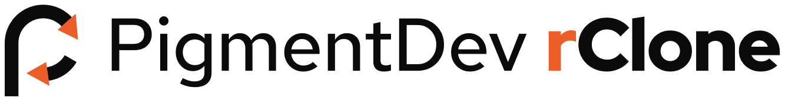
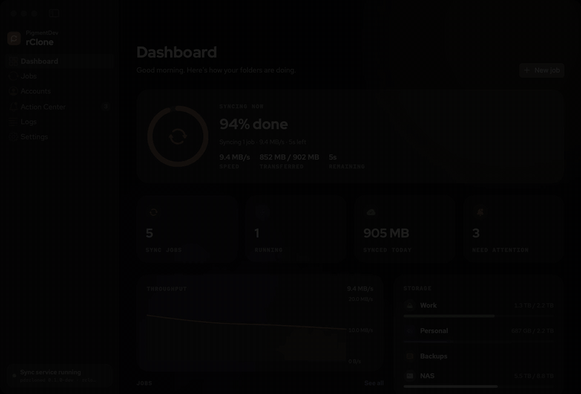

<p align="center">
  <picture>
    <source media="(prefers-color-scheme: dark)" srcset="brand/logo-horizontal-dark.svg">
    
  </picture>
</p>

<p align="center"><b>Sync the Mac folders you choose with Google Drive, OneDrive, Dropbox, S3 and more. Skip the rest.</b></p>

<p align="center">
  <a href="LICENSE"></a>
  <a href="https://github.com/pigment-dev/rclone/releases/latest"></a>
  
  <a href="https://rclone.org"></a>
</p>

<p align="center">
  <a href="https://pigment.dev/products/rclone/"><b>Website</b></a> ·
  <a href="https://pigment.dev/docs/rclone/">Documentation</a> ·
  <a href="https://pigment.dev/kb-topic/rclone/">Help and FAQs</a> ·
  <a href="https://github.com/pigment-dev/rclone/releases/latest/download/PigmentDev-rClone.dmg">Download for Mac</a>
</p>

<p align="center">
  
</p>

PigmentDev rClone is a free, open-source macOS app that keeps chosen folders on your Mac in sync with cloud and server storage, with one-way or two-way sync, schedules, and exclusions for `.git`, `node_modules` and other folders you don't want in the cloud. The sync engine is [rclone](https://rclone.org), embedded as a Go library. Windows and Linux get the sync daemon and the `pdrclone` CLI.

Features, screenshots, documentation and FAQs are on the **[product page](https://pigment.dev/products/rclone/)**.

## Install

```bash
brew install --cask pigment-dev/gui/rclone
```

Or download the [DMG](https://github.com/pigment-dev/rclone/releases/latest/download/PigmentDev-rClone.dmg). The CLI and daemon alone (macOS, Linux): `brew install pigment-dev/gui/pdrclone`. Linux and Windows archives are on the [Releases](https://github.com/pigment-dev/rclone/releases/latest) page.

The app is not signed with an Apple Developer ID yet. If macOS says it can't be opened, run:

```bash
xattr -dr com.apple.quarantine "/Applications/PigmentDev rClone.app"
```

## Build from source

You need Go 1.27+ and Xcode 26+. See [CONTRIBUTING.md](CONTRIBUTING.md).

```bash
git clone https://github.com/pigment-dev/rclone.git
cd rclone/core && go build ./cmd/...        # daemon and CLI
cd ../mac && scripts/build-app.sh           # macOS app, output in mac/dist/
```

The daemon and its clients talk over a local socket; the protocol is in [docs/PROTOCOL.md](docs/PROTOCOL.md).

## License

[MIT](LICENSE). Built by [Pigment Dev](https://pigment.dev). Sync engine: [rclone](https://rclone.org) by Nick Craig-Wood and contributors (MIT).

PigmentDev rClone is an independent project, not affiliated with the rclone project, Google, Microsoft, Dropbox or any other storage provider.
