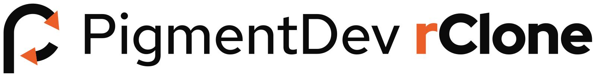

# PigmentDev rClone brand

The logo, app icon and colours for PigmentDev rClone. Everything here is built from one script, so change the numbers there rather than editing the SVGs by hand.



## The mark

A lowercase **r** drawn as a sync ring. The stem rises, turns over the top of the ring and ends in an arrowhead; a second, shorter arc on the lower right chases back towards the stem. Two arrows going the same way round is the usual sign for sync; the long stem turns the ring into the letter of rClone.

- **Body** (stem and arcs): Ink `#0B0B0B` on light grounds, Paper `#F3F4F5` on dark grounds.
- **Arrowheads**: always Orange `#EB5E28`, on any ground.
- Flat colour only. No gradients, glows, outlines or shadows (the Pigment Dev style guide rules these out). On macOS 26 the system adds Liquid Glass depth to the app icon by itself.

## Files

| File | Use it for |
|---|---|
| `logo-mark.svg` | The mark on light grounds |
| `logo-mark-dark.svg` | The mark on dark grounds |
| `logo-mono.svg` | One colour (`currentColor`, black by default): embossing, stamps, single-ink print |
| `logo-mark-small.svg` | Below 20 px: one arrow only, so the shape stays readable |
| `logo-horizontal.svg` / `logo-horizontal-dark.svg` | Mark + wordmark for headers, README, slides |
| `app-icon.svg` | macOS app icon source, 1024 × 1024, flat squircle on the Apple icon grid |
| `menubar-template*.svg` | Menu bar template images, 18 × 18 pt, black + alpha only (idle, attention, paused) |
| `favicon.svg`, `apple-touch-icon.svg` | Sources for the website icons in `docs/` |
| `png/` | PNG exports: app icon 16 to 1024, mark 64 to 1024, horizontal logo at 1600 px |
| `social-preview.png` | GitHub repository social preview, 1280 × 640 |
| `fonts/` | Red Hat Display, Text and Mono (SIL Open Font License, see `fonts/OFL.txt`) |

The wordmark text is converted to outlines, so the SVGs render the same without the fonts installed.

Generated elsewhere in the repo by the same tools:

- `mac/Resources/AppIcon.icns` (16 to 1024 at 1x and 2x)
- `mac/Resources/AppIcon.icon` (Icon Composer document: Ink fill, body and arrowhead layers with glass on)
- `mac/Resources/MenuBarIcon.pdf`, `MenuBarIcon-Attention.pdf`, `MenuBarIcon-Paused.pdf` (template PDFs; set `isTemplate = true`)
- `docs/favicon.svg`, `docs/favicon-32.png`, `docs/apple-touch-icon.png`, `docs/og.png`

## Wordmark

**PigmentDev** in Red Hat Text 500, then **rClone** in Red Hat Display 900 with the **r** in Orange. One line, never stacked. On dark grounds the text turns Paper and the r stays Orange.

Write the name as **PigmentDev rClone** in running text: one word for PigmentDev, a lowercase r and a capital C in rClone.

## Clear space and size

- **Clear space**: keep at least the width of one arrowhead (about a quarter of the mark's height) free on every side.
- **Minimum size**: the mark at 16 px (use `logo-mark-small.svg` below 20 px), the horizontal logo at 120 px wide.
- Do not rotate, stretch, recolour the arrowheads, add effects, put the mark in a circle, or place the Orange arrowheads on an Orange ground. On Orange, use `logo-mono.svg` in Ink.

## Colours

| Token | Hex | Role |
|---|---|---|
| Orange | `#EB5E28` | Arrowheads, the r in rClone, primary buttons (Ink text on top) |
| Ink | `#0B0B0B` | Body on light, dark grounds, text |
| Paper | `#F3F4F5` | Body on dark, light grounds |
| Stage Dark | `#191919` | Cards on Ink |
| Gray | `#E1E3E5` | Quiet fills |
| Line | `#C9CDD2` | Rules and hairlines |
| Secondary | `#4A4F55` | Secondary text on light |
| Muted | `#8C9197` | Hints and captions |
| Cobalt | `#2141F5` | Focus rings and links only; never next to Orange |
| Yellow | `#FFC72C` | Rare accent |
| Green | `#17A673` | Status dot only |

Never use white text on Orange (3.4 : 1) or Cobalt text on Ink (2.9 : 1).

## Type

- Headings: Red Hat Display 800 / 900, tight tracking (about -3.5%).
- Body: Red Hat Text 400 / 500.
- Labels, chips and code: Red Hat Mono 700, uppercase, +6% tracking.

## Rebuilding

```bash
pip3 install fonttools uharfbuzz      # once
brew install librsvg                   # once, for rsvg-convert
python3 brand/tools/build_brand.py     # SVGs + Icon Composer layers
brand/tools/export.sh                  # PNGs, .icns, menu bar PDFs, favicons
brand/tools/cards/render.sh            # docs/og.png and brand/social-preview.png (needs Google Chrome)
```

All geometry lives at the top of `tools/build_brand.py` (ring centre, radius, stroke, arrow angles and arrowhead size) on a 100-unit grid.
